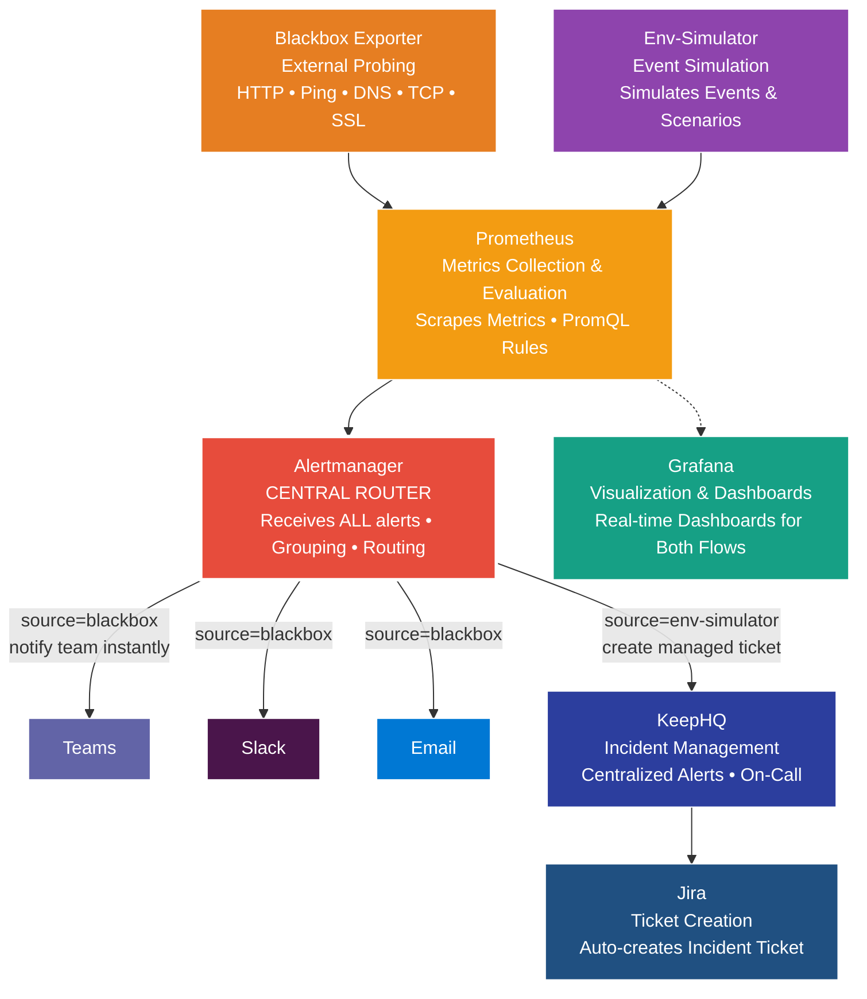

# Lab - Observability: Prometheus + Alertmanager + Keep

Monitoring architecture with centralized alert routing via **Alertmanager**.

The **Alertmanager is the CENTRAL ROUTER**. It receives ALL alerts from Prometheus and decides where they go, based on the source.

## Architecture



## How the flow works

| Source | Path | Destination | Goal |
| --- | --- | --- | --- |
| **Blackbox Exporter** | Blackbox -> Prometheus -> Alertmanager | Teams / Slack / Email | Notify the team instantly |
| **Env-Simulator** | Env-Simulator -> Prometheus -> Alertmanager | KeepHQ -> Jira | Create a managed ticket |

### 1. Instant Flow - Blackbox

External probes for HTTP, Ping, DNS, TCP and SSL.
If it fails, Prometheus fires an alert with `source=blackbox`.
Alertmanager routes it directly to **Teams / Slack / Email**.

> Rule: `source=blackbox` = notify team instantly

### 2. Managed Flow - Env-Simulator

Simulates environment events and scenarios.
Prometheus fires an alert with `source=env-simulator`.
Alertmanager routes it to **KeepHQ**, which centralizes, deduplicates and creates the ticket in **Jira**.

> Rule: `source=env-simulator` = create managed ticket

Keep does **not replace** Alertmanager. It is just **one of the destinations** of Alertmanager.

## Components

- **Prometheus:** Collects metrics and evaluates PromQL rules.
- **Alertmanager:** Receives all alerts, groups, silences and routes them.
- **Blackbox Exporter:** External probing.
- **Env-Simulator:** Event simulation.
- **KeepHQ:** Incident management and on-call.
- **Jira:** Automatic ticket creation.
- **Grafana:** Real-time dashboards for both flows.

## Routing in Alertmanager

Routing is done by label in `alertmanager.yml` (Example):

```yaml
global:
  resolve_timeout: 5m
  # Only fill if you really use email
  # smtp_smarthost: 'smtp.gmail.com:587'
  # smtp_from: 'alertmanager@your-domain.com'
  # smtp_auth_username: 'your-email'
  # smtp_auth_password: 'your-password'

route:
  receiver: keep
  group_by: ["alertname", "source"]
  group_wait: 10s
  group_interval: 10s
  repeat_interval: 30s
  routes:
    # 1. Instant Flow - Blackbox -> Teams / Slack / Email
        - matchers:
                - source="blackbox"
      receiver: teams-slack-email
      continue: false

    # 2. Managed Flow - Env-Simulator -> Keep -> Jira
        - matchers:
                - source="env-simulator"
      receiver: keep
      continue: false

receivers:
  # --- Destination 1: KeepHQ ---
    - name: keep
    webhook_configs:
            - url: http://keep-backend:8080/alerts/event/prometheus
        # - url: http://host.docker.internal:8080/alerts/event/prometheus
        send_resolved: true
        http_config:
          basic_auth:
            username: keep
            password: hidden

  # --- Destination 2: Teams / Slack / Email ---
    - name: teams-slack-email
    webhook_configs:
      # Teams - replace with your Incoming Webhook / Workflow URL
            - url: 'https://SEU-WORKSPACE.webhook.office.com/webhookb2/SEU-ID'
        send_resolved: true
      # Slack - replace with your Incoming Webhook URL
            - url: 'https://hooks.slack.com/services/SEU/WEBHOOK/AQUI'
        send_resolved: true
    # Email - uncomment if you want to use it
    # email_configs:
    #   - to: 'time-oncall@your-domain.com'
    #     send_resolved: true
```